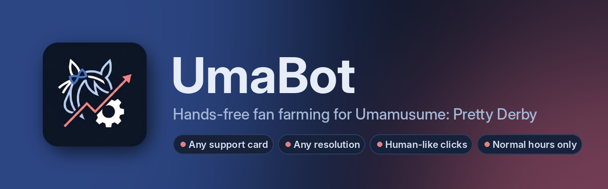
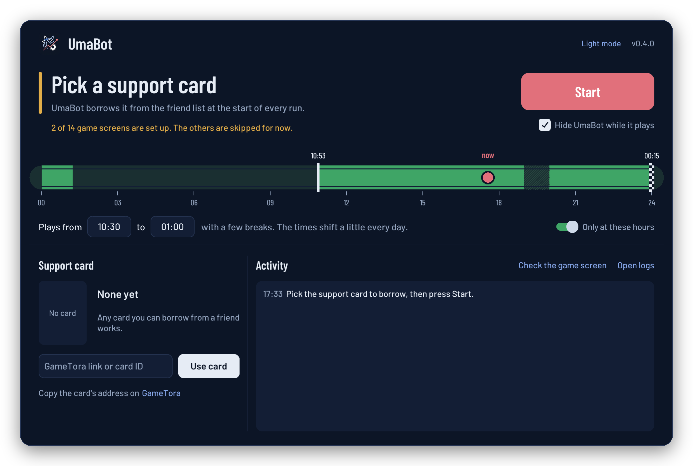
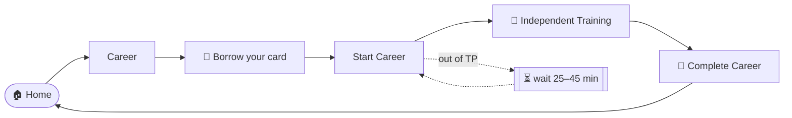

<p align="center">
  
</p>

<p align="center">
  <a href="https://github.com/karaasu13/UmaBot/releases/latest/download/UmaBot-windows.zip"></a>
  <a href="https://github.com/karaasu13/UmaBot/actions/workflows/ci.yml"></a>
  
</p>

<p align="center">
  <b>Pick a support card, press Start, and let it farm fans.</b><br>
  UmaBot finishes each Independent Training run, starts the next one and borrows your card every time,<br>
  clicking like a person and only at normal hours.
</p>

<p align="center">
  
</p>

> **Status:** early version, being tested with the game. The app shows how many game screens are set up under *Screens ready*.

## ✨ Features

| | |
|---|---|
| 🎴 **Any support card** | Paste a GameTora link and the bot finds that card in the friend list at the start of every run. |
| 🖥️ **Any resolution** | Windowed or fullscreen, any size, any monitor. It measures the game's scale by itself. |
| 🖱️ **Clicks like a person** | A different spot on every button, curved mouse paths, natural reaction times and the odd short pause. |
| 🌙 **Normal hours** | Plays in a daily window that shifts a little every day, with random breaks. No TP is ever wasted. |
| 🏁 **Today at a glance** | Your day drawn as a race track: start gate, finish post, hatched breaks and a dot for *now*. |
| 🛡️ **Safe by default** | Never spends carats or items, and stops on its own if something looks off. |
| 👀 **No game hacking** | It only looks at the screen and moves the mouse. No API calls, no memory reading, no modified files. |

## 🚀 Get started

1. **Download** [UmaBot-windows.zip](https://github.com/karaasu13/UmaBot/releases/latest/download/UmaBot-windows.zip) and unzip it anywhere.
2. **Open** `UmaBot.exe`. If Windows SmartScreen shows up: *More info* → *Run anyway*.
3. **Choose your card**: find it on [GameTora](https://gametora.com/umamusume/supports), copy the link, paste it and press **Set card**.
4. **Open Umamusume**, go to the home screen and press **▶ Start**.

That's it. Leave the game window visible (not minimised, nothing on top of it) and keep the PC from sleeping.
You can follow everything in **Activity**, and the track shows when it will play today. **F8** starts and stops,
and the switch at the top changes between dark and light mode.

## ⚙️ How it works



Every couple of seconds UmaBot takes a screenshot of the game window, works out which screen it's on and clicks the
right button, with human-like timing. Each screen is recognised from a small picture of its button.
The game does the training itself through **Independent Training**.

## 📊 How many runs a day?

TP refills at 1 point every 10 minutes and a run costs 30, so without spending anything you get **about 4.8 runs a day**
(24 every 5 days). The first day can reach 8 if you start with a full bar.

| Fans per run | Per day | Per week | Per month |
|---:|---:|---:|---:|
| 500k | ~2.4M | ~17M | ~72M |
| 1M | ~4.8M | ~34M | ~144M |

The schedule's nightly pause doesn't cost runs: TP keeps refilling (a full bar takes 16h40), and the bot uses it the next morning.

## 🛡️ Safety

- **Stops on its own** if a popup would spend carats, if the veterans list is full, if it's stuck on the same screen,
  or if it can't find your card 8 times in a row.
- **Out of TP?** It cancels and waits. It never uses Toughness items or carats.
- **Stop anytime** with the Stop button, or fling the mouse to the top-left corner of the screen.
- **Leaves a trail:** screenshots of anything unusual go to the `logs` folder (button *Logs*). It can also ping you on
  Discord: set `discord_webhook` in `config.toml`.

## ❓ FAQ

<details>
<summary><b>Can I get banned?</b></summary>

Cygames' Terms of Use forbid automation tools, so the risk is never zero. UmaBot uses the approach that's hardest to tell
apart from a person: it doesn't touch the game at all, clicks at different spots with natural timings, and only plays at
normal hours with breaks. Use it at your own risk.
</details>

<details>
<summary><b>Does it spend carats or items?</b></summary>

No. When TP runs out it cancels the popup and waits for TP to refill. If a popup that spends carats ever appears, it stops.
</details>

<details>
<summary><b>Can I use the PC while it runs?</b></summary>

Not really, because it needs the mouse. It's meant to run while you're away. *Minimise UmaBot while it plays* keeps the
app out of the way, and it comes back when the bot stops.
</details>

<details>
<summary><b>Which support cards work?</b></summary>

Any card you can borrow from the friend list. If the GameTora picture isn't recognised in your game, crop the card from a
screenshot and give the bot the `.png` instead of the link.
</details>

<details>
<summary><b>My game runs in a window / at another resolution. Is that OK?</b></summary>

Yes. The first time it sees a known button at a new window size it measures the game's scale, and it remembers it.
</details>

<details>
<summary><b>Does it work on the DMM (Japanese) version or on phones?</b></summary>

It's made for the Steam version on Windows.
</details>

## 🧑‍💻 For developers

<details>
<summary>Run from source, commands and project layout</summary>

```
pip install -r requirements.txt
python -m umabot              # opens the app
python -m umabot run          # runs the bot in the terminal, no window
python -m umabot card 30052   # choose the card (GameTora link, ID or .png)
python -m umabot test         # what the bot sees right now (+ screenshot in logs/)
python -m umabot schedule     # the next days' schedule
python -m umabot check        # rules and missing templates
python -m pytest              # tests (synthetic screens, no game needed)
```

Everything that decides what to click lives in [`config.toml`](config.toml): a list of **rules**, checked top to bottom,
each tied to one or more templates (small PNGs of buttons in [`templates/`](templates/)). Choices made in the app are saved
in `settings.json`.

```
umabot/
  gui.py       the app (customtkinter, dark and light themes)
  engine.py    rule engine and main loop
  vision.py    game window, screenshots, UI-scale detection, template matching
  human.py     human-like clicks, mouse paths and timings
  schedule.py  daily schedule with jitter and breaks
  tools.py     support card, test, check, crop
config.toml    settings and rules
templates/     button pictures
assets/        icon, banner, screenshot, fonts
```

Every push to `main` runs the tests, builds `UmaBot.exe` and publishes it to the
[latest release](https://github.com/karaasu13/UmaBot/releases/latest).
</details>

## ⚠️ Disclaimer

UmaBot is a fan-made tool, not affiliated with or endorsed by Cygames. Umamusume: Pretty Derby is © Cygames, Inc.
Automating the game goes against its Terms of Use: use it at your own risk.
Fallback button pictures come from [umamusume-auto-train](https://github.com/samsulpanjul/umamusume-auto-train), and card
pictures from [GameTora](https://gametora.com/umamusume). The app uses the [Barlow](https://github.com/jpt/barlow) typeface
(SIL Open Font License, see [`assets/fonts/OFL.txt`](assets/fonts/OFL.txt)).
