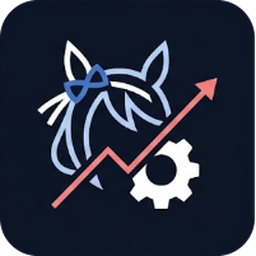

<p align="center"></p>

# UmaBot

Fan-farming bot for **Umamusume: Pretty Derby (Steam)**. It uses the game's own Independent Training,
finishes the run, starts a new one and always picks the **Light Hello** support card.

It never touches the game's API or files: it only takes screenshots of the window and clicks with the mouse, like a person.

> ⚠️ Cygames' Terms of Use forbid automation tools. This approach is the hardest to detect, but the risk
> is not zero. Use at your own risk.

## What makes it look human

- **Clicks spread over the button**: every click lands on a different point, most likely near the centre and never on the edges.
- **Curved mouse movement**: Bézier paths with acceleration and deceleration, speed that depends on distance and the occasional small overshoot that gets corrected.
- **Variable reaction times** (log-normal distribution), variable button hold time and occasional short pauses.
- **Normal hours**: it only starts runs inside a schedule (10:30 → 01:00 by default) that shifts by up to ±45 min every day, with 1 to 3 random breaks. A full night off wastes no TP, since TP takes 16h40 to fill up.
- **Out of TP**: it cancels the popup and waits 25–45 min. It never spends items or carats.

## Safety

- Stops on its own if a carats popup (`stop_carats`) or the veterans-list-full warning shows up.
- Stops if the same click repeats 25 times without the screen changing.
- Stops if it can't find Light Hello 8 times in a row.
- Saves screenshots to `logs/` whenever it stops or doesn't recognise the screen.
- Can notify you on Discord, if you add a webhook to `config.toml`.
- To stop it manually: Ctrl+C, or fling the mouse to the top-left corner of the screen.

## Install

**Option A: .exe (no Python).** Download
[**UmaBot-windows.zip**](https://github.com/karaasu13/UmaBot/releases/latest/download/UmaBot-windows.zip)
(rebuilt automatically on every push) and unzip it.

- Double-click `UmaBot.exe` to run the bot. The first time, it downloads the generic buttons on its own.
- For the other commands, open a terminal in that folder and use `UmaBot.exe <command>` instead of `python -m umabot <command>`.

**Option B: Python 3.11+**
```
pip install -r requirements.txt
```

## First time

```
python -m umabot download    # downloads the generic buttons and the Light Hello card
python -m umabot check       # lists the templates that are still missing (no game needed)
python -m umabot crop X      # crop each missing template, with the game open
python -m umabot test        # shows what the bot sees right now and what it would do
python -m umabot schedule    # shows the schedule for the next few days
python -m umabot             # runs the bot
```

The list of what still needs cropping, and where each thing is, lives in [`templates/README.md`](templates/README.md).

**The first time, watch it** for at least one full run and one time the TP runs out before leaving it alone.

## Any resolution, windowed or fullscreen

The game can run at any size, windowed or fullscreen, on any monitor. The bot finds the game window,
captures only that window and measures the UI scale by itself. In 16:9 it gets the scale right straight away. For
other shapes it measures it the first time it sees a known button. The result is saved per window size in
`calibration.json`, so it only has to measure once. If auto ever gets it wrong, set `scale` in `config.toml`.

## PC requirements

- The game window must be visible: not minimised and with nothing on top of it.
- The PC must not lock or sleep (Settings → Power → never). The monitor may turn off.
- While the bot runs, the mouse is its.

## Configuration

Everything is in [`config.toml`](config.toml): schedule, timings, thresholds and the **rules** that say what to do on each screen.
Rules are checked top to bottom and the first one that matches is executed. A rule that uses templates you don't
have yet disables itself.

## Layout

```
umabot/
  vision.py    game window, screenshots, UI-scale detection, template matching (multi-scale for the card)
  human.py     human-like clicks, paths and timings
  schedule.py  daily schedule with jitter and breaks
  engine.py    rule engine and main loop
  tools.py     download, check, test, crop, position, schedule
config.toml    configuration and rules
templates/     button crops
assets/        app icon
tests/         tests on a synthetic screen (run in CI)
```
